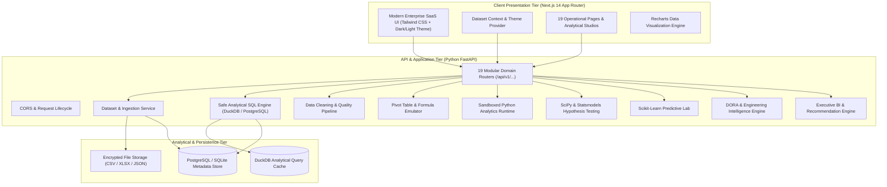

# DevPulse Architecture & System Design Documentation

## 1. System Topology & Architecture

DevPulse is architected as an enterprise-grade Software Quality and Engineering Productivity Intelligence platform that doubles as a full-spectrum analytical workspace for Data Analysts, Analytics Engineers, and Data Scientists.

---

## 2. Core Subsystems

### 2.1 Safe Read-Only Analytical SQL Engine
- **Engine**: In-Memory DuckDB backed by columnar vectors.
- **SQL Compatibility**: Full standard SQL supporting:
  - Common Table Expressions (CTEs, `WITH ... AS (...)`)
  - Analytical Window Functions (`RANK()`, `DENSE_RANK()`, `ROW_NUMBER()`, `LAG()`, `LEAD()`)
  - Aggregations and Grouping (`GROUP BY`, `HAVING`)
  - Execution Plan profiling (`EXPLAIN`)
- **Security Sandboxing**: Regex keyword interception blocks destructive DDL/DML operations (`DROP`, `DELETE`, `TRUNCATE`, `ALTER`, `UPDATE`, `INSERT`, `GRANT`, `REVOKE`).

### 2.2 Statistical Analysis & Experimentation
- **Descriptive Statistics**: Moments calculation (Mean, Median, Mode, Variance, Standard Deviation, Skewness, Kurtosis, IQR).
- **Hypothesis Testing**:
  - Welch's Two-Sample t-Test (independent samples with unequal variance)
  - Paired Samples t-Test (dependent repeated measures)
  - One-Way ANOVA (multi-group variance ratio testing)
  - Pearson's Chi-Square Test of Independence
- **A/B Experimentation Engine**:
  - Pooled Two-Proportion Z-Test
  - Statistical significance calculation at user-selected confidence thresholds (90%, 95%, 99%)
  - 95% Confidence Interval for proportion delta
  - Sample size recommendation for target statistical power (80% power at $\alpha=0.05$)

### 2.3 Predictive Machine Learning
- **Regression**: Ordinary Least Squares (OLS) Linear Regression and Random Forest Regressors with $R^2$, RMSE, MAE, MSE, and feature importance.
- **Classification**: Logistic Regression and Random Forest Classifiers with Accuracy, Precision, Recall, F1-Score, and Confusion Matrix.
- **Clustering**: K-Means clustering with optimal inertia scoring and cluster size distributions.
- **Time-Series Forecasting**: Exponential trend projections with 95% predictive confidence intervals.
- **Anomaly Detection**: Isolation Forest contamination scoring.

### 2.4 DORA & Engineering Productivity Guardrails
- **Authentic Engineering Intelligence**: DORA metrics (Deployment Frequency, Lead Time for Changes, Change Failure Rate, Time to Restore Service) are computed **strictly from verified deployment audit logs**.
- **Anti-Pattern Guard**: In strict compliance with industry engineering standards, **commit counts are never treated as individual productivity scores**.
- **Bottleneck Diagnostics**: Identifies structural workflow friction such as review turnaround latency and oversized pull request batches.

---

## 3. Data Flow & Transparency Disclosures

1. **Upload / Ingestion**: User uploads CSV, Excel, or JSON. The backend inspects column types, null counts, and dimensions, registering the dataset metadata in SQLAlchemy and its columnar representation in DuckDB.
2. **Synthetic Data Transparency**: All seeded demo datasets are explicitly flagged with `is_synthetic: true` and accompanied by clear synthetic origin disclosures displayed in the UI.
